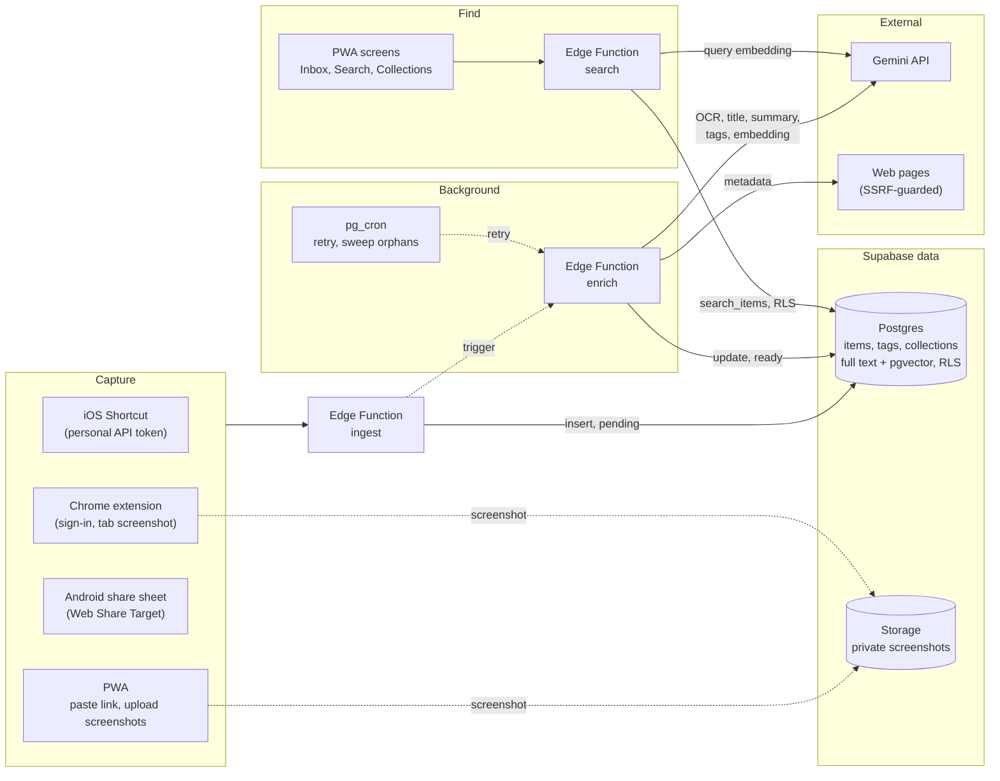
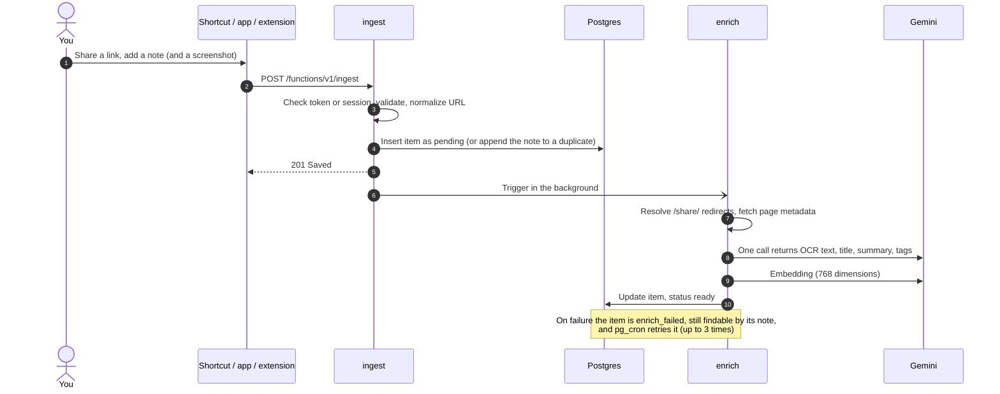
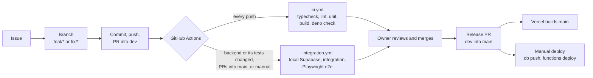

<p align="center">
  
</p>

<h1 align="center">Smart Link</h1>

<p align="center">
  A personal link vault. Save links and screenshots from Facebook, Instagram, Threads, Substack and the rest of the web with one share and a short note, then find them again by typing what you remember.
</p>

---

## Why

Links sent "to self" or to friends get lost in chat history. Bookmark tools save the URL, but Facebook, Instagram and Threads block reading the page, so the saved link often has no title and nothing to search. Smart Link treats **your own note and your screenshots** as the main signal, and lets AI fill in the rest when it can.

- **Saving is instant.** The item is stored first and enriched in the background. A failed fetch or AI call never loses a save.
- **Search forgives.** Vietnamese without diacritics matches (`dinh gia` finds `định giá`), and meaning-based search finds an item even when the words differ.
- **iPhone first.** It is a PWA, so it works on Android and on desktop too.

## Features

| Area | What you get |
|---|---|
| **Capture** | iOS Shortcut in the share sheet. In-app paste and screenshot upload. Android share sheet (Web Share Target). Chrome extension with a tab screenshot and a ✓ badge when the page is already saved. |
| **Enrich** | Page title and preview where readable. Gemini OCR of screenshots, plus an AI title, summary and tags (marked as AI and never overwriting your note). An embedding for semantic search. |
| **Find** | Hybrid search (full text with `unaccent` plus pgvector). Filters by source, tag and date. Tapping a result opens the original post. |
| **Organize** | Collections, with an optional read-only public link. A Resurface tab that brings back a few old, unseen items each day. Editing items and removing AI fields. |
| **Personalize** | Five themes, all checked for WCAG AA contrast. Light by default. |

Web Push reminders are built but **paused**. The code stays in place, and Resurface works in its tab.

## How it works



Every channel posts to **one** endpoint, `ingest`, which shares the same save logic. The browser only uses the public anon key under Row Level Security. The Gemini key and the service role key live in Edge Function secrets.

### Save, then enrich



## Tech stack

| Layer | Choice |
|---|---|
| Frontend | React 19, TypeScript (strict), Vite 6, Tailwind CSS 4, React Router 7, TanStack Query 5, Zod, `vite-plugin-pwa` |
| Backend | Supabase: Auth (email and password), Postgres with `unaccent`, `pgvector` and `pg_cron`, private Storage, Edge Functions (Deno) |
| AI | Gemini `gemini-3.5-flash-lite` (OCR, title, summary, tags) and `gemini-embedding-2` (768 dimensions), called from Edge Functions only |
| Extension | Chrome Manifest V3, built with Vite from the same repo |
| Tests | Vitest (unit and integration), Playwright (e2e at 390×844, live against local Supabase) |
| Hosting | Vercel (frontend), Supabase (backend) |

## Repository layout

```
src/                 PWA: screens, components, hooks, lib (api.ts is the only Supabase client)
supabase/
  migrations/        Schema, RLS, search_items(), cron jobs
  functions/         ingest, enrich, search, public-collection, sweep-screenshots, send-reminders
extension/           Chrome extension (popup, background worker)
tests/               unit, integration, e2e (mocked and live), fixtures, tools
.claude/             Project rules, architecture, business rules, workflow docs
```

## Getting started

**Requirements:** Node 22 and a Supabase project. A Gemini API key is optional: without it items still save and search uses full text only. Docker is needed only for the local Supabase stack.

```bash
npm install
cp .env.example .env      # then fill in the values below
npm run dev
```

| Where | Name | Notes |
|---|---|---|
| `.env` / Vercel | `VITE_SUPABASE_URL`, `VITE_SUPABASE_ANON_KEY` | Public values, also used to build the extension |
| Edge Function secrets | `GEMINI_API_KEY`, `GEMINI_MODEL` (optional), `CRON_SECRET` | Set with `npx supabase secrets set …`. Never in the frontend |
| Supabase Vault | `project_url`, `cron_secret` | Used by the `pg_cron` jobs to call functions |

First setup of a Supabase project:

```bash
npx supabase login
npx supabase link --project-ref <your-project-ref>
npx supabase db push
npx supabase secrets set GEMINI_API_KEY=… CRON_SECRET=…
npx supabase functions deploy --use-api
```

To run against a **local** backend instead, run `npx supabase start` and `npx supabase functions serve --env-file <file>`, then `npm run seed:local` to create test users. Details are in [`.claude/docs/development-workflow.md`](.claude/docs/development-workflow.md).

## Capture channels

- **iPhone (Shortcut):** in the app, open Settings and create a token. In Shortcuts, build: *Receive* **Any** *from Share Sheet* → *Text* (Shortcut Input) → *Ask for Text* (note) → *Get Contents of URL* (`POST {SUPABASE_URL}/functions/v1/ingest`, header `Authorization: Bearer <token>`, JSON `url` = Text, `note`, `channel` = `shortcut`) → *Show Notification* (Contents of URL). iOS web apps can't be share targets, which is why the Shortcut exists.
- **Android:** install the PWA from Chrome. It then appears in the share sheet.
- **Chrome:** run `npm run build:extension`, open `chrome://extensions`, turn on Developer mode, choose *Load unpacked* → `extension/dist`, and sign in from the popup. The "already saved" check runs on your device, so browsing URLs are never sent to the server.

## Development



```bash
npm run typecheck && npm run lint && npm test   # fast checks
npm run test:integration                        # needs local Supabase
npm run test:e2e                                # Playwright; live specs need local Supabase
npm run build && npm run build:extension
npm run gen:icons                               # re-render the logo into every icon size
```

Rules worth knowing before contributing:
- Change the schema in [`architecture-overview.md`](.claude/docs/architecture-overview.md) and in a migration first.
- Every table has `user_id` and RLS.
- User-facing text lives in `src/i18n/vi.ts`.
- Components call `src/lib/api.ts`, never Supabase directly.
- Saved content is untrusted: it is escaped on render and fetched behind SSRF guards.

The full rules are in [`CLAUDE.md`](CLAUDE.md) and [`.claude/rules/`](.claude/rules/).

## Deploy

The frontend deploys itself: Vercel builds `main`. The backend is deployed by hand from `main`:

```bash
npx supabase migration list            # what is pending
npx supabase db push                   # apply new migrations
npx supabase functions deploy --use-api
```

## Docs

- [Architecture and data model](.claude/docs/architecture-overview.md)
- [Business rules](.claude/docs/business-rules.md)
- [Development workflow, setup and deploy notes](.claude/docs/development-workflow.md)
- [Development plan and scope decisions](.claude/docs/development-plan.md)
